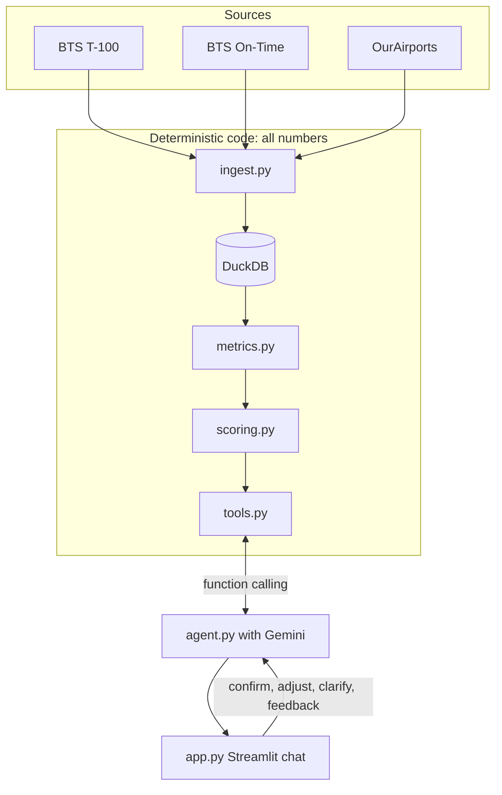

# Design

## 1. Architecture

| Step | File | What it does |
|---|---|---|
| Ingest | `ingest.py` | Cleans the raw files and writes monthly tables to DuckDB: `t100_monthly`, `ontime_monthly`, `airports` (with usable runway count) and `metadata` |
| Metrics | `metrics.py` | Uses SQL to compute one row per airport for the latest 12 months, plus the prior 12 months for growth |
| Scoring | `scoring.py` | Pure functions for normalization, weighting and the per-metric breakdown |
| Tools | `tools.py` | `resolve_airport`, `list_airports`, `airport_profile`, `rank_airports`, `compare_airports`, `long_haul_share`, `unmet_demand`, `live_status`. Each tool returns `results, assumptions, data_period, caveats, needs_review` |
| Agent | `agent.py` | Topic guardrail, system prompt, tool-calling loop, and pauses for analyst confirmation |
| UI | `app.py` | Chat, confirmation card, chart, a "How this was calculated" panel and feedback |

## 2. Scoring methodology

| Score | Metrics (weight) |
|---|---|
| **Investment opportunity** | YoY growth 30% · load factor 25% · congestion 25% · passengers 20% |
| **Unmet demand index** | load factor ⅓ · congestion ⅓ · YoY growth ⅓ |
| **Congestion** | delay rate 25% · avg taxi-out 25% · departures per runway 25% · cancellation rate 25% |

Inside the Investment and Unmet demand scores, "congestion" is the mean of three normalized components:
delay rate, taxi-out and departures per runway.

**Why each metric signals a profitable expansion:**
- **YoY passenger growth** (current 12 months vs the prior 12): rising demand will outgrow the current terminal.
- **Load factor** (passengers / seats): when planes are full, demand already uses up the capacity offered.
  Airlines would add flights if the airport had room for them.
- **Congestion**: delays (≥15 min), taxi-out time and departures per usable runway show that the
  infrastructure is under strain. Cancellations are included in the Congestion score only.
- **Passengers**: the same expansion at a bigger airport serves more travelers and earns more revenue.

**Normalization.**
- Each metric is scaled 0–100 with min-max within the peer group, and higher always means a stronger signal.
- Passengers use a log10 scale first, so mega-hubs do not flatten every other airport to near 0.
- If there is only one airport, or all airports are tied, they get 50.
- Region rankings compare only that region's airports. `compare_airports` and `unmet_demand` score against
  all US airports with ≥500k annual enplanements, so comparing two airports does not force them to 0 and 100.

**Missing data.** If an airport lacks a metric (e.g. it is not in on-time reporting), that metric's weight is
redistributed across its other metrics, and the answer shows a caveat. Each score comes with a breakdown
of normalized value × weight = contribution, and the contributions add up to the score.

## 3. AI vs deterministic code

| Deterministic (Python / SQL) | LLM (Gemini) |
|---|---|
| All metrics, scores, ranks and percentages | Picks the tool and its arguments |
| Peer groups, thresholds and weights | Explains the tool result in plain language |
| Name resolution (aliases and fuzzy match) | Keeps context for follow-ups ("and what about SNA?") |

The system prompt forbids numbers that did not come from a tool result. The answer format is a short table
with every number next to its airport code. A two-layer topic guardrail rejects off-topic questions: a light
LLM classifier, with a keyword allow-list as fallback, and the system prompt as the second layer. Rejected
questions are logged.

## 4. Human-in-the-loop

- **Ambiguous names** ("New York", "Chicago", "Portland"): the agent asks a question instead of guessing,
  and the analyst picks an option with a button.
- **Assumption confirmation**: before `rank_airports` or `unmet_demand` runs, a card shows the peer group
  (by name), the weights, the size threshold and the data period. The analyst can click **Run** or **Adjust**.
- **Needs-review flags**: the answer is flagged when an airport has no runway data, is not in on-time
  reporting, has fewer than 1,000 departures, has no prior-year data, or the peer group has fewer than 3 airports.
- **Overrides**: the analyst can use the weight sliders and exclude airports. When either is used, the answer
  is marked "manual override applied".
- **Feedback**: thumbs up/down plus a comment is saved to `feedback.jsonl` together with the question and the
  tools used.

## 5. Key tradeoffs

- **Local DuckDB snapshot vs live API**: BTS has no live API for this data. The snapshot is fast and reproducible, but not real-time. Live FAA status is an optional extra and never enters scores.
- **Min-max vs percentile**: min-max keeps real distances and is easy to explain, but is sensitive to outliers. Percentile is implemented as an alternative.
- **Observed YoY growth vs FAA TAF forecast**: same source as the other metrics, with no extra dataset or assumptions.
- **Unmet demand is a proxy**: non-travelers cannot be observed, so it is a relative index, not a passenger count.
- **National peer group**: regional rankings are not comparable across regions, so comparisons use the national group.
- **Gemini free tier**: limited daily quota. The agent falls back to other models and keys and shows a clear message when all are used.

## 6. Assumptions & limitations

**Independent verification.** I checked the results with Excel and separate SQL, not with the project code.
All of them matched:

| Check | Result |
|---|---|
| Anchorage long-haul share | 2.7% passenger-only, 29.5% including cargo |
| SNA congestion metrics | match |
| LAX vs SNA congestion score | 40.4 vs 34.8 |
| New England investment ranking | match |
| SFO unmet demand index | 55.1, rank 8 of 141 |

**Bugs found in testing and fixed.**
- The agent ran a national ranking for a single-airport question. Fix: a routing rule that sends
  single-airport questions to `airport_profile`.
- In a long answer, the LLM attached correct numbers to the wrong airport labels. Fix: a strict table-based
  answer format with every number next to its airport code.

**Limitations.**
- **Data period**: the window is Aug 2025 – Jul 2026, with growth measured against the prior 12 months.
  BTS publishes with a lag of a few months.
- **Default universe**: airports with ≥500k departing passengers a year (about 1M total).
- **Long haul**: the result is sensitive to the 3,000-mile threshold (DFW is 3,043 miles away) and to
  whether cargo is included. Both shares are reported when cargo changes the answer.
- **Runways**: runways under 3,000 ft, closed runways and water runways are not counted, so SNA counts as 1 runway.
- **Delay and cancellation data**: these cover only carriers that report on-time data, while T-100 covers
  all carriers.
- **Outliers**: min-max is sensitive to them. For example, CAK ranks #1 nationally for unmet demand, so
  percentile normalization is worth considering.
- **General context from the LLM**: the LLM may add general context that does not come from the data
  (e.g. "Anchorage is a major cargo hub").

## 7. Possible extensions

- FAA Terminal Area Forecast (TAF) for forward-looking demand
- Gate counts and terminal size as direct capacity measures
- Financial data (airport revenue, cost per enplanement)
- Voice input
